<p align="center">
  
</p>

<h1 align="center">Compose Components</h1>

<p align="center">
  <b>The Jetpack Compose components Material 3 doesn't ship, built to feel like they always belonged there.</b><br/>
  Date picker · Wheel picker · OTP input · Rating bar · Timeline · Color picker
</p>

<p align="center">
  
  
  
  
</p>

<p align="center">
  <a href="https://nameisjayant.github.io/Compose-Components/">
    
  </a>
</p>

<p align="center">
  Full documentation, with examples and every parameter for each component:<br/>
  <b><a href="https://nameisjayant.github.io/Compose-Components/">nameisjayant.github.io/Compose-Components</a></b>
</p>

---

Every component takes its colors, shapes and typography from `MaterialTheme`, so it matches whatever theme your app already uses, dynamic color included. Each one also has `colors()` / `accentColors()` helpers, a slot for drawing parts yourself, animations you can tune or turn off, haptics, right-to-left support and screen-reader semantics.

<table>
  <tr>
    <td align="center"><a href="#-composedatepicker">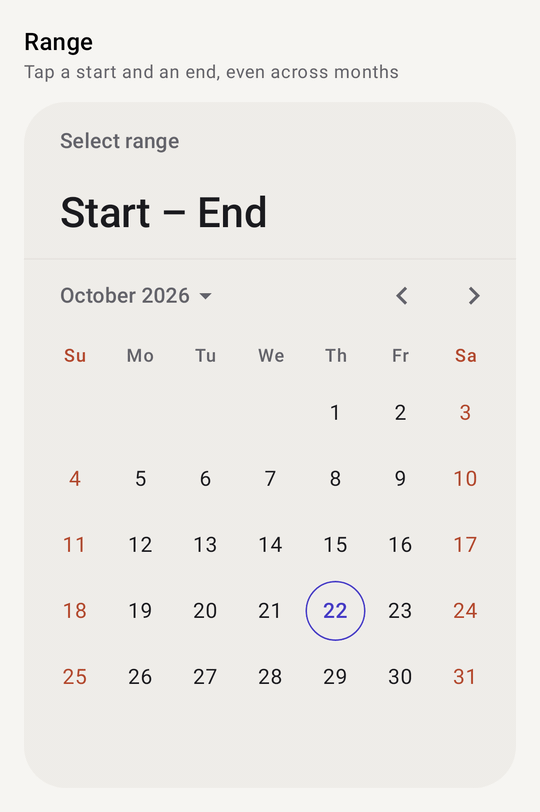</a><br/><b>Date picker</b></td>
    <td align="center"><a href="#-composewheelpicker">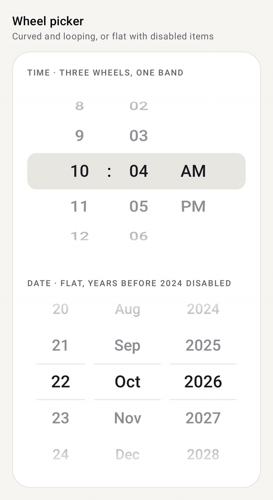</a><br/><b>Wheel picker</b></td>
    <td align="center"><a href="#-composeotpinput">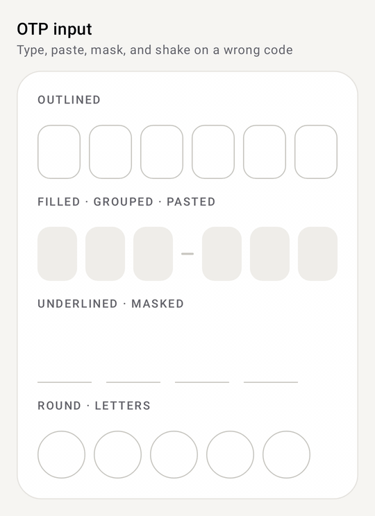</a><br/><b>OTP input</b></td>
  </tr>
  <tr>
    <td align="center"><a href="#-composeratingbar">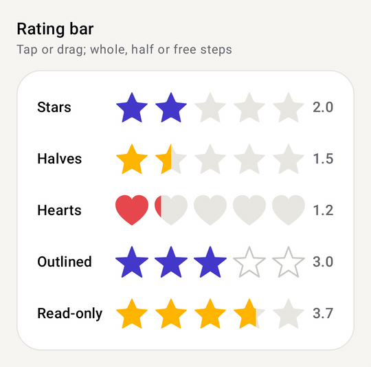</a><br/><b>Rating bar</b></td>
    <td align="center"><a href="#-composetimeline">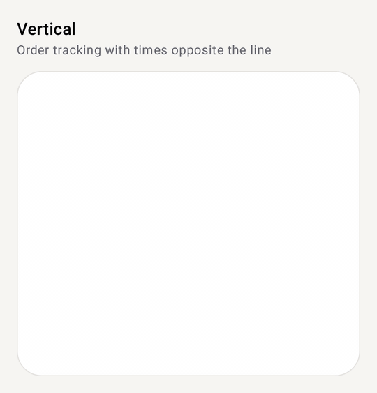</a><br/><b>Timeline</b></td>
    <td align="center"><a href="#-composecolorpicker">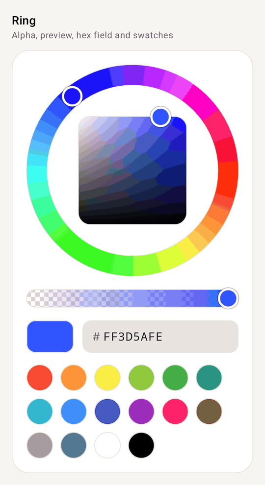</a><br/><b>Color picker</b></td>
  </tr>
</table>

## 📦 Installation

The library is published to Maven Central. Make sure `mavenCentral()` is in your repositories, then add:

```kotlin
// build.gradle.kts
dependencies {
    implementation("io.github.nameisjayant:compose-components:<version>")
}
```

<details>
<summary>Version catalog</summary>

```toml
[versions]
composeComponents = "<version>"

[libraries]
compose-components = { group = "io.github.nameisjayant", name = "compose-components", version.ref = "composeComponents" }
```

```kotlin
implementation(libs.compose.components)
```
</details>

| Requirement | |
| --- | --- |
| `minSdk` | 24. Dates use the library's own `CalendarDate`, so you don't need core library desugaring |
| Compose | Material 3 is brought in through the Compose BOM as an `api` dependency |
| Imports | Everything lives under `com.nameisjayant.components.<component>`, e.g. `com.nameisjayant.components.datepicker.*` |

### Shared conventions

Once you've learned one component, you know how the rest are put together:

| Pattern | What it looks like |
| --- | --- |
| **Theme first** | `XxxDefaults.colors(...)` reads `MaterialTheme.colorScheme`; override only the colors you care about |
| **One accent** | `XxxDefaults.accentColors(accent)` repaints the highlights in a single brand color |
| **Tweak a copy** | Every colors class has `copy(...)` |
| **State or value** | The date picker is state-driven; the wheel and color pickers come as both a `rememberXxxState()` overload and a plain value + callback overload; the OTP input and rating bar are plain value + callback |
| **Custom drawing** | A slot such as `dayContent`, `cellContent`, `itemContent` or `indicator` gets the item's full state |
| **Motion** | Animated components take an `XxxAnimation(...)` to tune them, or `XxxAnimation.None` to turn them off |
| **Survives rotation** | `rememberXxxState()` uses `rememberSaveable`, so state survives configuration changes and process death |

---

## 📅 ComposeDatePicker

A month calendar for picking **one date**, a **date range** or **several dates**. Swipe or use the arrows to change month, and tap the month title to jump to another year.

<table>
  <tr>
    <td align="center"><br/><sub>Range, across months</sub></td>
    <td align="center">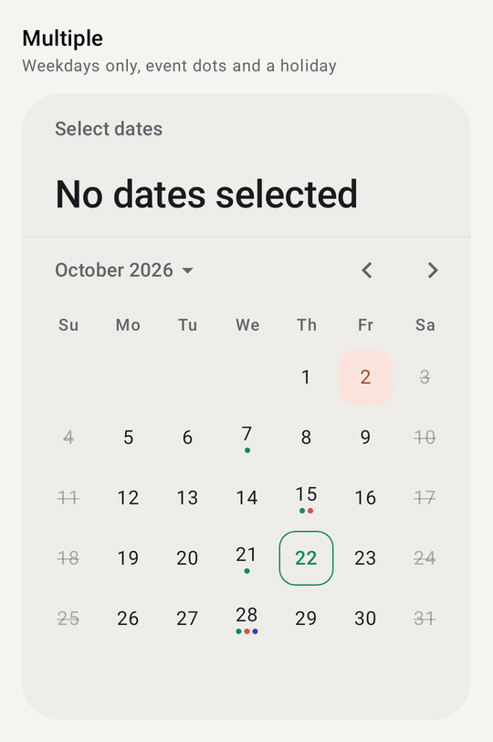<br/><sub>Multiple, weekdays only, event dots</sub></td>
    <td align="center">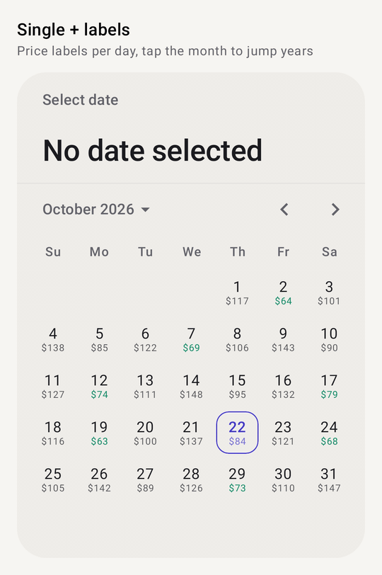<br/><sub>Single, price labels, year grid</sub></td>
  </tr>
</table>

### Quick start

```kotlin
val state = rememberComposeDatePickerState()          // Single by default

ComposeDatePicker(state = state)

state.selectedDate                                     // CalendarDate? e.g. 2026-10-22
```

### Selection modes

```kotlin
// One date
val single = rememberComposeDatePickerState(
    selectionMode = DateSelectionMode.Single,
    initialSelectedDate = CalendarDate.today(),
)
single.selectedDate                    // CalendarDate?

// A start and an end. The first tap sets the start, the second the end.
val range = rememberComposeDatePickerState(selectionMode = DateSelectionMode.Range)
range.selectedRange                    // ClosedRange<CalendarDate>?, null until both ends are picked
range.rangeStart; range.rangeEnd       // each end on its own

// Any number of dates. Tapping a selected date removes it.
val multiple = rememberComposeDatePickerState(
    selectionMode = DateSelectionMode.Multiple,
    maxSelectionCount = 5,             // optional cap
)
multiple.selectedDates                 // Set<CalendarDate>
```

The state can also be driven from code: `select(date)`, `setRange(start, end)`, `clearSelection()`, `isSelected(date)`, `isSelectable(date)`, `hasSelection`, and `displayedMonth` (read it, or set it to jump to a month).

### Disabling dates

```kotlin
val today = CalendarDate.today()
val state = rememberComposeDatePickerState(
    selectionMode = DateSelectionMode.Range,
    minDate = today,                                    // hard bounds: the picker won't page past them
    maxDate = today.plusMonths(6),
    selectableDates = SelectableDates.WeekdaysOnly and
        SelectableDates.except(publicHolidays),         // combine rules with `and` / `or`
    allowDisabledDatesInRange = false,                  // a range can't jump over disabled days
)

ComposeDatePicker(state, strikeThroughDisabledDays = true)
```

| Built-in rule | Selects |
| --- | --- |
| `SelectableDates.All` | every date (the default) |
| `SelectableDates.WeekdaysOnly` / `WeekendsOnly` | Monday to Friday / Saturday and Sunday |
| `SelectableDates.notBefore(date)` / `notAfter(date)` | on or after / on or before a date |
| `SelectableDates.except(dates)` | everything except a collection of dates |
| `SelectableDates.exceptDaysOfWeek(WeekDay.Sunday, ...)` | everything except some days of the week |
| `SelectableDates { date -> ... }` | your own rule (it's a `fun interface`) |

`state.selectableDates` is mutable, so you can swap the rule at runtime, for example once booked dates have loaded.

### Decorating days

Return a `DayDecoration` for the days that need one: up to three **dots**, a short **label**, a tinted **background**, or a different **number color**. Mix them however you like.

```kotlin
ComposeDatePicker(
    state = state,
    decoration = { date ->
        when {
            date in holidays -> DayDecoration(containerColor = Color(0xFFFBE4DC), contentColor = Color(0xFFB4472B))
            date in events -> DayDecoration(dots = listOf(Color.Unspecified, Color.Red)) // Unspecified = colors.decorationColor
            else -> prices[date]?.let { DayDecoration(label = "$$it", labelColor = Color(0xFF0F8A66)) }
        }
    },
)

DayDecoration.dot()                    // shorthand for a single dot
```

### Drawing days yourself

`dayContent` replaces what's drawn inside each day. The picker still draws the selection background, today's outline and the range band, and `LocalContentColor` is set to the color the default text would use.

```kotlin
ComposeDatePicker(
    state = state,
    dayContent = { info: DayInfo ->
        Column(horizontalAlignment = Alignment.CenterHorizontally) {
            Text("${info.date.dayOfMonth}", fontWeight = if (info.isToday) FontWeight.Bold else null)
            info.decoration?.label?.let { Text(it, fontSize = 8.sp) }
        }
    },
)
```

`DayInfo` has `date`, `isCurrentMonth`, `isEnabled`, `isSelected`, `isToday`, `isRangeStart`, `isRangeEnd`, `isInRange` and `decoration`.

### In a dialog

```kotlin
if (showPicker) {
    val state = rememberComposeDatePickerState(initialSelectedDate = booking.date)
    ComposeDatePickerDialog(
        onDismissRequest = { showPicker = false },
        confirmButton = {
            TextButton(onClick = { booking = booking.copy(date = state.selectedDate); showPicker = false }) { Text("OK") }
        },
        dismissButton = { TextButton(onClick = { showPicker = false }) { Text("Cancel") } },
    ) {
        ComposeDatePicker(state)
    }
}
```

### Look and feel

```kotlin
ComposeDatePicker(
    state = state,
    colors = ComposeDatePickerDefaults.accentColors(Color(0xFF0F8A66)),  // or .colors(...) / .copy(...)
    shape = RoundedCornerShape(28.dp),
    dayShape = ComposeDatePickerDefaults.RoundedDayShape,               // CircleShape by default
    firstDayOfWeek = WeekDay.Monday,                                    // the locale's first day by default
    showAdjacentMonthDays = true,
    highlightWeekends = true,
    title = null,                                                       // hide the small label…
    headline = { Text("When are you flying?") },                        // …or replace the big summary
)
```

### Working with dates

The picker uses its own small `CalendarDate` / `CalendarMonth` types instead of `java.time`, so it works on minSdk 24 without desugaring.

```kotlin
val date = CalendarDate(2026, 10, 22)           // or CalendarDate.today(), CalendarDate.parse("2026-10-22")
date.plusDays(7); date.minusMonths(1); date.daysUntil(other)
date.dayOfWeek; date.isWeekend; date.calendarMonth
date.format("yMMMd")                            // "Oct 22, 2026", ordered for the user's locale

date.toEpochMillisUtc()                         // ↔ CalendarDate.ofEpochMillisUtc(millis)
date.epochDay                                   // ↔ CalendarDate.ofEpochDay(days)
CalendarDate.from(calendar)                     // from java.util.Calendar

val month = CalendarMonth(2026, 10)             // or CalendarMonth.current()
month.firstDay; month.lastDay; month.lengthOfMonth; date in month
month.format("MMMMy")                           // "October 2026"
```

<details>
<summary><b>All parameters</b></summary>

**`ComposeDatePicker`**

| Parameter | Default | Description |
| --- | --- | --- |
| `state` | | Selection, displayed month and rules, from `rememberComposeDatePickerState` |
| `colors` | `ComposeDatePickerDefaults.colors()` | Colors of every part of the picker |
| `shape` | `RectangleShape` | Outline of the picker; also clips its background |
| `dayShape` | `CircleShape` | Shape of the selection, today's outline and decoration backgrounds |
| `firstDayOfWeek` | locale's | Leftmost column |
| `showAdjacentMonthDays` | `false` | Show neighbouring months' days in empty cells (not tappable) |
| `highlightToday` | `true` | Outline today's date |
| `highlightWeekends` | `false` | Color Saturday and Sunday with `weekendContentColor` |
| `strikeThroughDisabledDays` | `false` | Strike through disabled days as well as dimming them |
| `yearSelectionEnabled` | `true` | Tapping the month title opens a year grid |
| `decoration` | `null` | `(CalendarDate) -> DayDecoration?` |
| `title` | "Select date" | Small label at the top; `null` hides it |
| `headline` | selection summary | Large text under the title; `null` hides it (hiding both also hides the divider) |
| `dayContent` | `null` | `@Composable (DayInfo) -> Unit` to draw each day yourself |

**`rememberComposeDatePickerState`**: `selectionMode`, `initialSelectedDate`, `initialSelectedRange`, `initialSelectedDates`, `initialDisplayedMonth`, `minDate` (1900-01-01), `maxDate` (2100-12-31), `selectableDates`, `maxSelectionCount`, `allowDisabledDatesInRange`.

**`ComposeDatePickerDialog`**: `onDismissRequest`, `confirmButton`, `dismissButton`, `shape`, `containerColor` (match it to the picker's `containerColor`), `tonalElevation`, `properties`, `content`.

**`ComposeDatePickerColors`**: `containerColor`, `titleContentColor`, `headlineContentColor`, `navigationContentColor`, `weekdayContentColor`, `weekendContentColor`, `dayContentColor`, `disabledDayContentColor`, `adjacentMonthDayContentColor`, `todayContentColor`, `todayBorderColor`, `selectedDayContainerColor`, `selectedDayContentColor`, `rangeContainerColor`, `rangeContentColor`, `decorationColor`, `dividerColor`, `yearContentColor`, `currentYearContentColor`, `selectedYearContainerColor`, `selectedYearContentColor`.

`accentColors(accent, onAccent, containerColor)` derives the selection, today, range and year colors from one accent.
</details>

---

## 🎡 ComposeWheelPicker

A scrolling wheel for picking one item from a list: hours, minutes, months, sizes, anything. **Drag** or **fling** it and it snaps so a row rests on the selection line. **Tap** a row to spin to it.

<p align="center"></p>

### Quick start

```kotlin
var month by rememberSaveable { mutableIntStateOf(0) }

ComposeWheelPicker(
    items = listOf("Jan", "Feb", "Mar", "Apr", "May", "Jun", "Jul", "Aug", "Sep", "Oct", "Nov", "Dec"),
    selectedIndex = month,
    onSelectedIndexChange = { month = it },    // called once the wheel comes to rest
)
```

Change `month` from outside and the wheel spins to it.

### With a state: live selection and scrolling from code

```kotlin
val minutes = rememberComposeWheelPickerState(initialIndex = 30)
val scope = rememberCoroutineScope()

ComposeWheelPicker(
    items = (0..59).map { "%02d".format(it) },
    state = minutes,
    cyclic = true,                             // loops forever in both directions
)

minutes.selectedIndex                          // follows the wheel live, even mid-fling
minutes.isScrollInProgress
scope.launch { minutes.animateScrollToIndex(0) } // or scrollToIndex(0) to jump; cyclic takes the short way round
```

### Several wheels as one picker

Turn each wheel's own indicator off and draw one band behind the row, one `itemHeight` tall:

```kotlin
Box(contentAlignment = Alignment.Center) {
    ComposeWheelPickerDefaults.SelectionBand(Modifier.fillMaxWidth().height(ComposeWheelPickerDefaults.ItemHeight))
    Row(verticalAlignment = Alignment.CenterVertically) {
        ComposeWheelPicker(items = (1..12).toList(), state = hours, cyclic = true, selectionIndicator = null,
            modifier = Modifier.width(72.dp), contentDescription = "Hours")
        Text(":", style = MaterialTheme.typography.titleLarge)
        ComposeWheelPicker(items = (0..59).map { "%02d".format(it) }, state = minutes, cyclic = true,
            selectionIndicator = null, modifier = Modifier.width(72.dp), contentDescription = "Minutes")
        ComposeWheelPicker(items = listOf("AM", "PM"), state = amPm, selectionIndicator = null,
            modifier = Modifier.width(72.dp))
    }
}
```

### Flat style, disabled items and lists that change

```kotlin
val days = (1..CalendarMonth(year, month).lengthOfMonth).toList()  // the list can change, e.g. 31 → 28

ComposeWheelPicker(
    items = days,
    state = dayState,                                  // keeps its item, or the last one if the list got shorter
    style = WheelPickerStyle.Flat,                     // rows shrink and fade instead of curving
    selectionIndicator = { ComposeWheelPickerDefaults.SelectionLines() },
    isItemEnabled = { index -> days[index] >= earliestDay }, // dimmed and skipped
)
```

`WheelPickerStyle(curved, outerAlpha, outerScale)` lets you tune the look between `Wheel` and `Flat`.

### Custom rows

```kotlin
ComposeWheelPicker(items = sizes, state = state) { item: WheelPickerItem<Size> ->
    Row(verticalAlignment = Alignment.CenterVertically) {
        Text(item.value.label, fontWeight = if (item.isSelected) FontWeight.Bold else null)
        if (!item.isEnabled) Text("  sold out", style = MaterialTheme.typography.labelSmall)
    }
}
```

Custom rows still curve and fade with the wheel, and get the selected or plain text color as `LocalContentColor`.

<details>
<summary><b>All parameters</b></summary>

| Parameter | Default | Description |
| --- | --- | --- |
| `items` | | Any `List<T>`; may change while shown |
| `state` *or* `selectedIndex` + `onSelectedIndexChange` | | Pick the overload you need. The state overload also takes an optional `onSelectedIndexChange` |
| `modifier` | | Set the width here; without one it's `ComposeWheelPickerDefaults.Width` (96dp). Height is `itemHeight × visibleItemCount` |
| `enabled` | `true` | Ignore touch and use disabled colors when `false` |
| `cyclic` | `false` | Wrap the list so it spins endlessly |
| `visibleItemCount` | `5` | Rows shown at once; must be odd |
| `itemHeight` | `48.dp` | Height of each row |
| `style` | `WheelPickerStyle.Wheel` | `Wheel` (curved drum), `Flat`, or `WheelPickerStyle(curved, outerAlpha, outerScale)` |
| `textStyle` / `selectedTextStyle` | `titleLarge`, centered | Label styles; their color comes from `colors` |
| `colors` | `ComposeWheelPickerDefaults.colors()` | `textColor`, `selectedTextColor`, `disabledItemTextColor`, `disabledTextColor`, `indicatorColor`, `indicatorLineColor` |
| `selectionIndicator` | `SelectionBand()` | Drawn behind the selected row; `SelectionLines()`, your own, or `null` |
| `fadeEdges` | `true` | Fade rows out at the top and bottom |
| `isItemEnabled` | all enabled | Disabled items are dimmed and skipped |
| `selectOnTap` | `true` | Tapping a row spins to it |
| `hapticFeedbackEnabled` | `true` | A light tick each time a row passes the line |
| `flingBehavior` | snap fling | State overload only; how a fling decays and snaps |
| `contentDescription` | `null` | What the wheel picks ("Hours"), read out with the selected label |
| `itemLabel` | `toString()` | Text of each row, also used for accessibility |
| `itemContent` | `null` | `@Composable (WheelPickerItem<T>) -> Unit` with `index`, `value`, `isSelected`, `isEnabled` |

**Accessibility:** the wheel is one adjustable control. Screen readers read the description and the selected label, and swipe up or down to change it.
</details>

---

## 🔢 ComposeOtpInput

A one-time-code field split into cells. Typing fills the cells one by one, backspace clears them, and **pasting** or **SMS autofill** drops a whole code in at once. Characters the input doesn't accept, such as the dash in `529-174`, are skipped.

<p align="center"></p>

### Quick start

```kotlin
var code by rememberSaveable { mutableStateOf("") }

ComposeOtpInput(
    value = code,
    onValueChange = { code = it },
    onComplete = { viewModel.verify(it) },   // called when the last cell is filled; the keyboard closes
)
```

### Error state

```kotlin
ComposeOtpInput(
    value = code,
    onValueChange = { code = it; wrongCode = false },
    isError = wrongCode,                     // red cells, the row shakes and the phone buzzes when it turns true
)
```

### Styles, groups and sizing

```kotlin
ComposeOtpInput(
    value = code,
    onValueChange = { code = it },
    length = 6,
    cellStyle = OtpCellStyle.Filled,                                    // Outlined | Filled | Underlined
    colors = ComposeOtpInputDefaults.accentColors(Color(0xFF0F8A66), OtpCellStyle.Filled),
    cellSize = DpSize(Dp.Unspecified, 52.dp),                           // unspecified width = share the row
    groupSize = 3,                                                      // 529 – 174
    separator = { ComposeOtpInputDefaults.Separator() },
)

// Round cells
ComposeOtpInput(code, { code = it }, cellShape = ComposeOtpInputDefaults.CircleCellShape, cellSize = DpSize(46.dp, 46.dp))
```

Pass the same `style` to `colors(style)` / `accentColors(accent, style)` as to `cellStyle`; they pick suitable container and border colors for it.

### PINs and other input types

```kotlin
// Masked PIN that shows each digit for a moment
ComposeOtpInput(value = pin, onValueChange = { pin = it }, length = 4, mask = true, revealMillis = 600)

// Letters, uppercased as they're typed or pasted
ComposeOtpInput(value = code, onValueChange = { code = it }, inputType = OtpInputType.Letters, uppercase = true)

// Your own rule, e.g. hex characters
ComposeOtpInput(value = code, onValueChange = { code = it }, inputType = OtpInputType.Any,
    charFilter = { it.isDigit() || it.lowercaseChar() in 'a'..'f' })
```

`OtpInputType` is `Digits` (number pad), `Letters`, `Alphanumeric` or `Any`.

### Custom cells

```kotlin
// PIN dots instead of boxes
ComposeOtpInput(value = pin, onValueChange = { pin = it }, length = 4) { cell: OtpCell ->
    Box(
        Modifier
            .size(16.dp)
            .background(if (cell.isFilled) MaterialTheme.colorScheme.primary else Color.Transparent, CircleShape)
            .border(2.dp, if (cell.isActive) MaterialTheme.colorScheme.primary else MaterialTheme.colorScheme.outline, CircleShape),
    )
}
```

`OtpCell` has `index`, `char`, `text` (masked if needed), `isActive`, `isFilled`, `isError` and `isEnabled`.

<details>
<summary><b>All parameters</b></summary>

| Parameter | Default | Description |
| --- | --- | --- |
| `value` / `onValueChange` | | The code, and the callback with the new code |
| `length` | `6` | Number of cells |
| `onComplete` | `null` | Called once with the full code when the last cell is filled |
| `enabled` / `readOnly` | `true` / `false` | Disabled ignores focus; read-only can be focused and copied but not changed |
| `isError` | `false` | Error colors, plus a shake and a buzz when it turns true |
| `inputType` | `Digits` | Accepted characters and default keyboard |
| `charFilter` | `inputType::accepts` | Overrides which characters are accepted |
| `uppercase` | `false` | Capitalise letters |
| `mask` / `maskChar` / `revealMillis` | `false` / `●` / `600` | Password-style masking, briefly showing the last character |
| `placeholder` | `null` | Character shown in empty cells, e.g. `'0'` |
| `cellStyle` | `Outlined` | `Outlined`, `Filled` or `Underlined` |
| `cellSize` | `48 × 56 dp` | `Dp.Unspecified` width shares the row; unspecified height makes cells square |
| `cellSpacing` | `8.dp` | Gap between cells and around separators |
| `cellShape` | `RoundedCornerShape(12.dp)` | `CircleCellShape` for round cells |
| `borderWidth` / `focusedBorderWidth` | `1.dp` / `2.dp` | Idle and active/error borders (or underlines) |
| `textStyle` | `headlineSmall`, medium | Its color comes from `colors` |
| `colors` | `colors(cellStyle)` | Container, border and text colors for idle, focused, filled, error and disabled cells, plus `placeholderColor` and `cursorColor` |
| `groupSize` / `separator` | `0` / dash | Split into groups with a separator between them |
| `showCursor` | `true` | Blinking cursor in the active cell |
| `autoFocus` | `false` | Focus and open the keyboard on first show |
| `clearFocusOnComplete` | `true` | Close the keyboard when complete |
| `keyboardType` / `imeAction` / `keyboardActions` | from `inputType` / `Done` / default | Keyboard options |
| `animation` | `OtpInputAnimation.Default` | `OtpInputAnimation(slideInText, popScale, blinkCursor, shakeOnError, shakeDistance)` or `.None` |
| `hapticFeedbackEnabled` | `true` | Confirm tick when complete, buzz on error |
| `interactionSource` | `null` | Observe focus and press interactions |
| `cellContent` | `null` | `@Composable (OtpCell) -> Unit` to draw cells yourself |

Cells always run left to right, also in right-to-left layouts, since codes are read that way. The field tells autofill services it holds an SMS one-time code.
</details>

---

## ⭐ ComposeRatingBar

A row of stars, hearts, circles, or any `Shape` or `Painter`, for showing and picking a rating. **Tap** an item to rate, or **drag** across the bar and the rating follows your finger.

<p align="center"></p>

### Quick start

```kotlin
var rating by rememberSaveable { mutableFloatStateOf(3f) }

ComposeRatingBar(
    rating = rating,
    onRatingChange = { rating = it },
    onRatingChangeFinished = { viewModel.save(rating) },   // when the finger lifts
)
```

### Steps, read-only and limits

```kotlin
ComposeRatingBar(rating, { rating = it }, stepSize = 0.5f)     // halves (1f = whole, 0f = any value)

ComposeRatingBar(rating = 3.7f, onRatingChange = null)         // read-only; fractions draw partly filled

ComposeRatingBar(
    rating = rating,
    onRatingChange = { rating = it },
    maxRating = 10,
    minRating = 1f,                                            // at least one star
    allowClear = false,                                        // tapping the current rating won't reset it
)
```

### Shapes and colors

```kotlin
// Gold stars
ComposeRatingBar(rating, { rating = it }, colors = ComposeRatingBarDefaults.accentColors(ComposeRatingBarDefaults.Gold))

// Hearts
ComposeRatingBar(rating, { rating = it }, shape = ComposeRatingBarDefaults.HeartShape,
    colors = ComposeRatingBarDefaults.accentColors(Color(0xFFE5484D)))

// Outline-only empty stars
ComposeRatingBar(rating, { rating = it }, shape = ComposeRatingBarDefaults.SharpStarShape,
    borderWidth = ComposeRatingBarDefaults.OutlineWidth, colors = ComposeRatingBarDefaults.outlinedColors())

// Any star, or any Compose shape
ComposeRatingBar(rating, { rating = it }, shape = ComposeRatingBarDefaults.starShape(points = 6, innerRadiusRatio = 0.5f, roundness = 0.3f))
ComposeRatingBar(rating, { rating = it }, shape = CircleShape, itemSize = 20.dp, itemSpacing = 4.dp)

// An icon, tinted with the bar's colors
ComposeRatingBar(rating, { rating = it }, painter = painterResource(R.drawable.ic_thumb_up))
```

### Animation

When the rating grows, items fill one after another with a soft bounce, the tapped item pops and sends out a halo, and the item under your finger lifts while you drag.

```kotlin
ComposeRatingBar(
    rating, { rating = it },
    animation = RatingBarAnimation(staggerMillis = 80, popScale = 1.4f, showHalo = false), // or RatingBarAnimation.None
)
```

<details>
<summary><b>All parameters</b></summary>

| Parameter | Default | Description |
| --- | --- | --- |
| `rating` | | Current rating, `0..maxRating` |
| `onRatingChange` | | New rating while tapping or dragging; `null` makes the bar read-only |
| `maxRating` | `5` | Number of items |
| `stepSize` | `1f` | `1f` whole, `0.5f` halves, `0f` any value |
| `minRating` | `0f` | Lowest rating the user can pick |
| `enabled` | `true` | Ignore input and use the disabled colors when `false` |
| `allowClear` | `true` | Tapping the current rating resets it to `minRating` |
| `itemSize` / `itemSpacing` | `32.dp` / `6.dp` | Item size and gap |
| `shape` | `StarShape` | `StarShape`, `SharpStarShape`, `HeartShape`, `starShape(points, innerRadiusRatio, roundness)` or any `Shape` |
| `painter` | `null` | Draw a tinted `Painter` instead of `shape` |
| `borderWidth` | `0.dp` | Stroke around each item; use `OutlineWidth` with `outlinedColors()` |
| `colors` | `ComposeRatingBarDefaults.colors()` | `activeColor`, `inactiveColor`, `activeBorderColor`, `inactiveBorderColor`, `disabledActiveColor`, `disabledInactiveColor`, `haloColor` |
| `animation` | `RatingBarAnimation.Default` | `RatingBarAnimation(staggerMillis, waveScale, popScale, dragScale, showHalo)` or `.None` |
| `hapticFeedbackEnabled` | `true` | Tick as the rating changes under the finger |
| `onRatingChangeFinished` | `null` | Called when a tap or drag ends |

TalkBack users can adjust the rating with the standard slider actions. Right-to-left layouts fill from the right. Animations run in the draw phase, so the bar doesn't recompose while it moves.
</details>

---

## 🧭 ComposeTimeline

Steps joined by a line: order tracking, onboarding progress, a history of events. Each step gets an **indicator** on the line, **content** beside it and, optionally, **opposite content** on the other side. The line is drawn as reached up to the furthest reached step, and grows into the next step when it's reached.

<table>
  <tr>
    <td align="center"><br/><sub>Vertical, with opposite content</sub></td>
    <td align="center">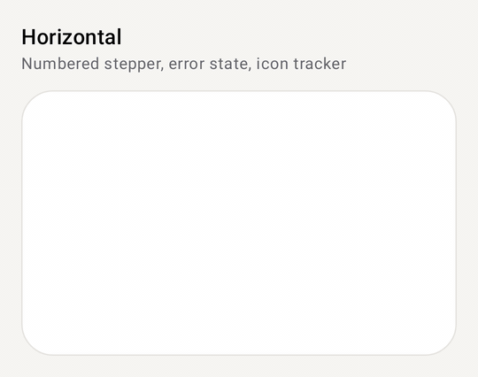<br/><sub>Horizontal: numbers, error state, icons</sub></td>
  </tr>
</table>

### Quick start

```kotlin
ComposeTimeline(
    items = orderSteps,
    stepState = { index, _ -> TimelineStepState.forProgress(index, currentStep) },
    pendingLineStyle = TimelineLineStyle.Dashed,             // the line after the current step
    oppositeContent = { step -> Text(step.item.time) },
) { step ->
    Text(step.item.title, style = MaterialTheme.typography.titleSmall)
    Text(step.item.description, style = MaterialTheme.typography.bodySmall)
}
```

`TimelineStepState` is `Completed`, `Active` (pulses), `Upcoming` or `Error`. `forProgress(index, currentIndex)` makes earlier steps completed, the current one active and later ones upcoming; pass `currentIndex = items.size` to complete them all. Bump `currentStep` and the line fills into the next step.

### Horizontal stepper

```kotlin
ComposeTimeline(
    items = listOf("Cart", "Address", "Payment", "Done"),
    orientation = TimelineOrientation.Horizontal,
    stepState = { index, _ -> if (index == current && paymentFailed) TimelineStepState.Error else TimelineStepState.forProgress(index, current) },
    indicatorSize = 28.dp,
    indicator = { step ->
        if (step.state == TimelineStepState.Completed) StatusIndicator(step.state)
        else NumberIndicator("${step.index + 1}", step.state)
    },
) { step -> Text(step.item) }
```

Horizontal steps share the width equally; give them an `itemWidth` to put a long timeline in a horizontally scrolling container. Tracks line up however tall the content above them is.

### Indicators and lines

```kotlin
indicator = { step -> StatusIndicator(step.state) }                       // default: ring, pulsing dot, check, "!"
indicator = { step -> NumberIndicator("${step.index + 1}", step.state) }
indicator = { step -> IconIndicator(painterResource(R.drawable.ic_truck), step.state) } // Painter or ImageVector
indicator = { step -> MyBadge(step, colors.completedColor, indicatorSize) }  // the scope has colors, indicatorSize, animation

lineStyle = TimelineLineStyle.Solid                                       // reached part
pendingLineStyle = TimelineLineStyle.Dotted                               // the rest
TimelineLineStyle(width = 3.dp, dashLength = 8.dp, gapLength = 4.dp, cap = StrokeCap.Round)
```

### Layout options

```kotlin
ComposeTimeline(
    items = events,
    contentSide = TimelineContentSide.Alternate,               // Start | End | Alternate (line down the middle)
    indicatorAlignment = TimelineIndicatorAlignment.Center,    // level with the start of the content, or centered
    itemSpacing = 24.dp, contentSpacing = 16.dp, lineGap = 4.dp,
    oppositeContentFraction = 0.3f,
    key = { it.id },                                           // keeps animations when items move
) { step -> EventCard(step.item, alignEnd = step.contentSide == TimelineContentSide.Start) }
```

### Long timelines in a LazyColumn

```kotlin
LazyColumn(contentPadding = PaddingValues(16.dp)) {
    item { Header() }
    timelineItems(events, key = { it.id }) { step -> EventCard(step.item) }
    item { LoadMore() }
}
```

`timelineItems` takes the same parameters as the vertical `ComposeTimeline`, plus `contentType`.

<details>
<summary><b>All parameters</b></summary>

| Parameter | Default | Description |
| --- | --- | --- |
| `items` | | One per step |
| `stepState` | all `Completed` | `(index, item) -> TimelineStepState` |
| `key` | `null` | Stable key per item |
| `orientation` | `Vertical` | `Vertical` or `Horizontal` |
| `contentSide` | `End` | `Start`, `End` or `Alternate` (start/end edges vertically, above/below horizontally) |
| `indicatorAlignment` | `Start` | `Start` or `Center` relative to the content |
| `indicatorSize` | `24.dp` | Default indicator size, and the width of the line's track |
| `itemSpacing` / `contentSpacing` / `lineGap` | `24.dp` / `16.dp` / `0.dp` | Gaps between steps, beside the line, and around indicators |
| `itemWidth` | `Dp.Unspecified` | Horizontal only; unspecified shares the width |
| `oppositeContentFraction` | `0.3f` | Share of the space that opposite content gets |
| `lineStyle` / `pendingLineStyle` | `Solid` / `lineStyle` | `Solid`, `Dashed`, `Dotted` or `TimelineLineStyle(width, dashLength, gapLength, cap)` |
| `colors` | `ComposeTimelineDefaults.colors()` | `completedColor`, `onCompletedColor`, `activeColor`, `onActiveColor`, `upcomingColor`, `errorColor`, `onErrorColor`, `containerColor`, `completedLineColor`, `upcomingLineColor`, `haloColor` |
| `animation` | `TimelineAnimation.Default` | `TimelineAnimation(revealItems, staggerMillis, lineFillMillis, pulseActive)` or `.None` |
| `indicator` | `StatusIndicator` | `TimelineIndicatorScope.(TimelineStep<T>) -> Unit` |
| `oppositeContent` | `null` | Drawn on the other side of the line |
| `content` | | Drawn beside each indicator |

`TimelineStep<T>` has `index`, `item`, `state`, `count`, `contentSide`, `orientation`, `isFirst` and `isLast`. Each step reads to screen readers as one item with its state ("Completed", "In progress"…) and its place in the list. Right-to-left layouts mirror everything.
</details>

---

## 🎨 ComposeColorPicker

A full color picker: a hue/saturation/brightness area in one of three styles, then an alpha slider, a before/after preview, a hex field and preset swatches. It works in HSV, so dragging to gray or black and back keeps the hue.

<table>
  <tr>
    <td align="center">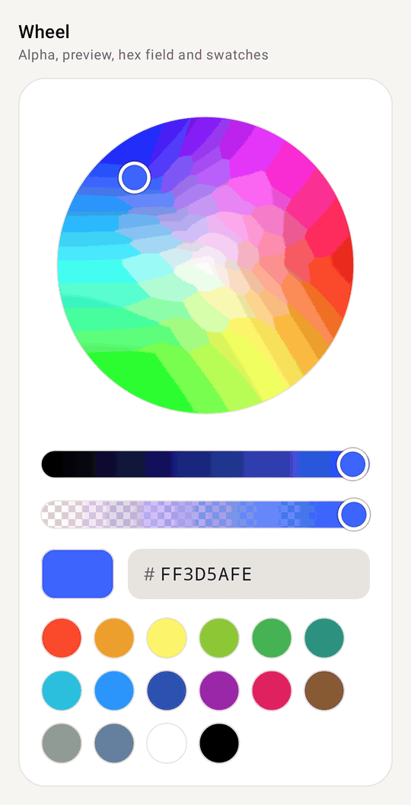<br/><sub><code>ColorPickerStyle.Wheel</code></sub></td>
    <td align="center"><br/><sub><code>ColorPickerStyle.Ring</code></sub></td>
    <td align="center">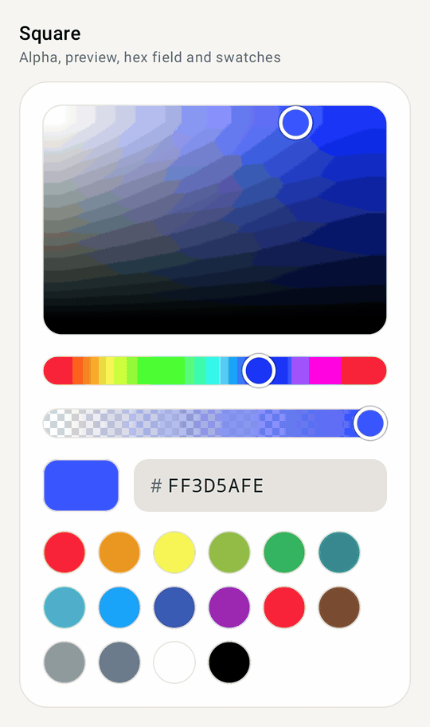<br/><sub><code>ColorPickerStyle.Square</code></sub></td>
  </tr>
</table>

### Quick start

```kotlin
// Plain value + callback
var color by remember { mutableStateOf(Color(0xFF3D5AFE)) }
ComposeColorPicker(color = color, onColorChange = { color = it })

// Or a state you can read and set any time
val state = rememberComposeColorPickerState(initialColor = Color(0xFF3D5AFE))
ComposeColorPicker(
    state = state,
    style = ColorPickerStyle.Ring,                    // Wheel | Ring | Square
    originalColor = Color(0xFF3D5AFE),                // split preview; tap the old half to go back
    onColorChangeFinished = { recents.add(it) },      // finger lifted, swatch tapped or hex entered
)
state.color = Color.Red                               // or state.hsvColor = HsvColor(…)
```

### Choose what's shown

```kotlin
ComposeColorPicker(
    state = state,
    showAlpha = false,                                  // no alpha slider; the hex field shows RRGGBB
    showPreview = true,
    showHexField = true,
    swatches = brandColors,                             // emptyList() for none
    colors = ComposeColorPickerDefaults.accentColors(MaterialTheme.colorScheme.tertiary),
    thumbSize = 24.dp, sliderHeight = 20.dp, ringWidth = 24.dp,
    panelShape = RoundedCornerShape(8.dp), swatchSize = 32.dp, spacing = 12.dp,
)
```

The hex field accepts `RGB`, `ARGB`, `RRGGBB` and `AARRGGBB`, with or without `#`. Codes without alpha keep the current alpha.

### In a dialog

```kotlin
if (show) {
    val state = rememberComposeColorPickerState(initialColor = current)
    ComposeColorPickerDialog(
        onDismissRequest = { show = false },
        title = { Text("Pick a color") },
        confirmButton = { TextButton(onClick = { save(state.color); show = false }) { Text("OK") } },
        dismissButton = { TextButton(onClick = { show = false }) { Text("Cancel") } },
    ) {
        ComposeColorPicker(state, Modifier.padding(horizontal = 24.dp), originalColor = current)
    }
}
```

The dialog's content scrolls when the screen is too short for it.

### Build your own picker from the parts

Every piece is public and stateless (`hsvColor` + `onHsvColorChange`), so you can lay them out however you like:

```kotlin
var hsv by remember { mutableStateOf(HsvColor.from(Color(0xFF3D5AFE))) }

Column(verticalArrangement = Arrangement.spacedBy(12.dp)) {
    SaturationValuePanel(hsv, { hsv = it }, aspectRatio = 2f)
    HueSlider(hsv, { hsv = it })
    SaturationSlider(hsv, { hsv = it })
    BrightnessSlider(hsv, { hsv = it })
    AlphaSlider(hsv, { hsv = it })
    Row(horizontalArrangement = Arrangement.spacedBy(12.dp)) {
        ColorPreview(hsv.toColor())
        ColorHexField(hsv, { hsv = it }, Modifier.weight(1f))
    }
    ColorSwatches(ComposeColorPickerDefaults.Swatches, selectedColor = hsv.toColor(), onSwatchClick = { hsv = HsvColor.from(it, hsv) })
}
```

Also available: `HueSaturationWheel` and `HueRingPanel`. `HsvColor(hue, saturation, value, alpha)` has `toColor()`, `toArgb()`, `copy(...)` and `HsvColor.from(color, previous)`, which keeps the previous hue for grays.

<details>
<summary><b>All parameters</b></summary>

| Parameter | Default | Description |
| --- | --- | --- |
| `state` *or* `color` + `onColorChange` | | Pick the overload you need |
| `onColorChange` | `null` | (state overload) Every change while dragging |
| `onColorChangeFinished` | `null` | When a drag ends, a swatch is tapped or a hex code is entered |
| `style` | `Wheel` | `Wheel` (disc + brightness slider), `Ring` (hue ring around a square), `Square` (panel + hue slider) |
| `enabled` | `true` | Dimmed and ignores touch when `false` |
| `showAlpha` / `showPreview` / `showHexField` | `true` | Toggle each section |
| `originalColor` | `null` | Shown beside the current color in the preview; tap it to go back |
| `swatches` | `ComposeColorPickerDefaults.Swatches` | 16 everyday colors; `emptyList()` hides the row |
| `colors` | `ComposeColorPickerDefaults.colors()` | `thumbColor`, `thumbBorderColor`, `borderColor`, `checkerboardLightColor`, `checkerboardDarkColor`, `selectedSwatchBorderColor`, `fieldContainerColor`, `fieldTextColor`, `fieldLabelColor`, `fieldBorderColor`, `fieldFocusedBorderColor` |
| `thumbSize` / `sliderHeight` / `ringWidth` | `28` / `24` / `28.dp` | Thumb and track sizes |
| `panelShape` | `RoundedCornerShape(16.dp)` | Corners of the saturation/brightness panel |
| `swatchSize` / `spacing` | `36.dp` / `16.dp` | Swatch size and gap between sections |

The picker fills the width its `modifier` gives it. Sliders are adjustable for screen readers ("Hue, 210°", "Opacity, 80%"), panels read their hex code, and swatches are radio buttons named by their hex code. State survives configuration changes and process death, hue included.
</details>

---

## 🧪 Demo app

The `:app` module is a catalog with a demo screen per component, controls for their main options, and a light/dark toggle. Open the project in Android Studio and run **app**.

| Module | What's in it |
| --- | --- |
| `:components` | The library (`com.nameisjayant.components`), published to Maven Central |
| `:app` | The demo catalog (`com.nameisjayant.composecomponents`) |

### Re-recording the GIFs

The GIFs in this README are recorded off-device. A Robolectric test (`app/src/test/.../docs/RecordComponentGifs.kt`) renders each scene, drives it with real taps, drags and typing on a paused clock, and saves every frame. Then ffmpeg turns the frames into GIFs:

```bash
./scripts/record-gifs.sh              # every scene → docs/gifs/*.gif
./scripts/record-gifs.sh ratingBar    # just one
```

## 🤝 Contributing

Issues and pull requests are welcome. When you add or change a component, please add a demo screen to `:app`, unit tests for its logic in `components/src/test`, a scene in `RecordComponentGifs`, and a section in this README.

## 📄 License

```
Copyright 2026 Jayant Kumar

Licensed under the Apache License, Version 2.0 (the "License");
you may not use this file except in compliance with the License.
You may obtain a copy of the License at

    http://www.apache.org/licenses/LICENSE-2.0

Unless required by applicable law or agreed to in writing, software
distributed under the License is distributed on an "AS IS" BASIS,
WITHOUT WARRANTIES OR CONDITIONS OF ANY KIND, either express or implied.
See the License for the specific language governing permissions and
limitations under the License.
```
